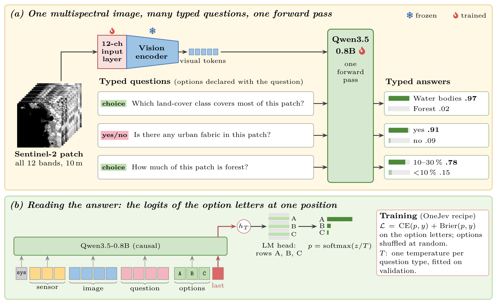

<div align="center">

<h2>EarthJev 🛰️: Calibrated, Non-Generative Answers to Natural-Language Questions about Sentinel-2 Land Cover</h2>

[Domenico Benfenati](https://scholar.google.com/citations?user=tjH_pzcAAAAJ),
[Antonio Maria Rinaldi](https://scholar.google.com/citations?user=pVe1IPYAAAAJ),
[Cristian Tommasino](https://scholar.google.com/citations?user=kTJBBRYAAAAJ)

Department of Electrical Engineering and Information Technology (DIETI), University of Naples Federico II

<p>
  &nbsp;&nbsp;&nbsp;&nbsp;
  &nbsp;&nbsp;&nbsp;&nbsp;
  
</p>

[](#citation)
[](https://huggingface.co/dBenf/EarthJev)
[](LICENSE)


</div>

---

## News

- **2026/11**: Code, results and the model weights ([🤗 dBenf/EarthJev](https://huggingface.co/dBenf/EarthJev)) released with the preprint.

## Introduction

**EarthJev** answers typed questions about a multispectral Sentinel-2 patch. You give it one image with all **12 bands** and any number of questions, each with the options it allows (yes/no, one of *K* classes, an ordered level). Each question is answered with **a single forward pass** that returns a **probability for every option**, trained to be calibrated. No token is generated, so every answer is valid by construction, and no other model's output enters its input: the model sees only the image and the questions.

<p align="center">
  
</p>

<p align="center"><em><b>EarthJev framework.</b> (a) All 12 bands of a Sentinel-2 patch enter the vision encoder of Qwen3.5-0.8B through a widened input layer, the only trained part of the encoder; each typed question declares its options, and a single forward pass returns a probability for each of them. (b) The answer is read from the logits of the option letters at the last position, trained with cross-entropy plus Brier score and calibrated with one temperature per question type. The probabilities shown are illustrative.</em></p>

### Highlights

- 🛰️ **All 12 Sentinel-2 bands.** The first layer of the vision encoder is widened from 3 to 12 channels (B01–B12 with B8A). The R, G, B kernels are copied onto B04, B03, B02 and the other nine bands start at zero, so before training the model computes exactly what the RGB model computes (checked: identical logits).
- 🎯 **Typed, valid answers.** Yes/no, multiple choice and ordinal questions, each read at its option letters. No free text to parse.
- 📏 **Trained for calibration.** Cross-entropy plus Brier score, with one temperature per question type fitted on validation data.
- ⚡ **Fast.** 19.9 ms per question on one H100: **4.3–8.7× faster** than multimodal LLMs fine-tuned on the same data and **6.8× faster** than the same backbone trained to generate the answer. All the questions about an image take 42.8 ms (3.7–10.1× faster than batched generation).
- 🔁 **Open recipe.** Built on the open [OneJev](https://github.com/OmniJev/OneJev) training recipe (included unmodified as a submodule) and [Qwen3.5-0.8B](https://huggingface.co/Qwen/Qwen3.5-0.8B).

## Benchmarks

| Benchmark | Images | Questions | Question types | Role |
|---|---:|---:|---|---|
| CORINE questions on BigEarthNet v2 (5% subset, test split) | 5,991 | 36,028 | dominant class, presence, share, quadrant, comparison | in-domain test; a second test set rephrases every question with unseen templates |
| EuroSAT-MS (spatial split, test) | 5,400 | 27,000 | land-cover class, 4 class groups | in-domain test |
| RSVQAxBEN (presence) | — | 29,501 | yes/no presence | transfer test, never used for training |
| BigEarthNet.txt benchmark | — | 12,477 | 6,927 binary, 5,550 multiple choice | transfer test against published numbers |

Training uses 70,890 CORINE questions on 11,893 BigEarthNet v2 patches and 81,000 EuroSAT-MS questions on 16,200 images. Test images are disjoint from training images. All questions are generated from reference maps or dataset labels; none are written by an LLM.

### Results

All models are trained on the same 70,890 CORINE questions with three seeds and timed in one job on one H100 PCIe GPU
(batch 1, bfloat16; each timer runs from the decoded image in memory to the answer, preprocessing and tokenisation
included). CORINE: accuracy on the 36,028 test questions (mean ± std over seeds) and ECE (mean of the per-seed ECEs, 15
bins); RSVQAxBEN: 29,501 presence questions written by other authors, never used for training. *Slower than EarthJev*:
latency of the model divided by that of EarthJev; *ms / image*: all the questions of an image (6.1 on average) in one
request (EarthJev shares the image prefix; generative models answer in one batched generation).

| Model | Params | Input | CORINE acc. (%) | ECE | RSVQAxBEN acc. (%) | ms / question | Slower than EarthJev | ms / image (all questions) | Slower than EarthJev |
|---|---|---|---|---|---|---|---|---|---|
| **EarthJev (ours)** | **0.8B** | **12 bands** | **86.0 ± 0.1** | **0.006** | **81.0** | **19.9** | — | **42.8** | — |
| Qwen3.5-0.8B, generative | 0.8B | 12 bands | 86.8 ± 0.2 | 0.005 | 80.5 | 134.7 | 6.8× | 191.9 | 4.5× |
| Qwen3-VL-2B, LoRA | 2.1B | RGB | 86.6 ± 0.1 | 0.005 | 80.6 | 111.6 | 5.6× | 176.2 | 4.1× |
| InternVL3-2B, LoRA | 2.1B | RGB | 87.1 ± 0.0 | 0.006 | 81.2 | 84.5 | 4.3× | 157.3 | 3.7× |
| EarthDial-4B, LoRA | 4.2B | RGB | 89.5 ± 0.1 | 0.006 | 82.4 | 171.8 | 8.7× | 431.6 | 10.1× |
| ResNet-50 VQA* | 0.14B | 12 bands | 87.5 ± 0.2 | 0.089 | 79.4 | 12.1 | 0.6× | 14.9 | 0.3× |
| Swin-T VQA* | 0.15B | 12 bands | 86.5 ± 0.1 | 0.047 | 79.6 | 16.2 | 0.8× | 17.9 | 0.4× |
| MambaVision-T VQA* | 0.15B | 12 bands | 85.9 ± 0.3 | 0.064 | 78.4 | 15.3 | 0.8× | 18.6 | 0.4× |

\* Fixed-vocabulary VQA models (image encoder on 12 bands + sentence encoder, classification over the training answers):
a reference for the cost of a model that answers only the questions and options it was trained on, not a competitor.

- **Bands are used:** replacing the nine non-RGB bands with their training mean costs 4.5 points on CORINE (all seeds).
- **Valid answers by construction:** on the BigEarthNet.txt multiple-choice questions, whose options were never seen in
  training, the same backbone trained to generate answers outside the four options for 45.9% of the questions; EarthJev
  always returns a distribution over the declared options.
- Full results, ablations and the pre-specified analysis plan are in the paper.

## Installation

```bash
git clone --recursive https://github.com/CosmoIknosLab/EarthJev && cd EarthJev
bash env/build_env.sh            # conda env with PyTorch, transformers and OneJev (qev[train])
source env/activate.sh           # sets S1GEO_DATA, HF_HOME, TORCH_HOME under ./data
pytest tests/                    # 12-band preprocessing, input layer and metrics
```

The EarthDial baseline runs in its own environment: see `env/earthdial_README.md`.

## Getting started

The Slurm scripts in `scripts/slurm/` and `scripts/analysis/submit_msi.sh` were written for our cluster: adapt the
`#SBATCH` lines (partition, GPU type) to yours. On nodes whose GPUs cannot talk peer-to-peer they set
`NCCL_P2P_DISABLE=1`.

<details open>
<summary><b>1. Data</b></summary>

```bash
# raw sources (checksums verified): reBEN metadata and reference maps, BigEarthNet.txt, RSVQAxBEN test split
bash scripts/data/download_sources.sh
bash scripts/data/download_rsvqaxben.sh

# reBEN 5% subset: the Sentinel-2 archive is streamed from Zenodo and only the selected patches are kept (~2.6 GB)
sbatch scripts/data/prepare_reben.sbatch 0.05 data/reben/subset_5pct
python scripts/data/reben_rgb.py --subset data/reben/subset_5pct      # RGB stretch (also used by the 12-band input)

# questions: CORINE (English), BigEarthNet.txt benchmark, RSVQAxBEN presence
python scripts/data/make_reben_questions.py --subset data/reben/subset_5pct --italian 0 --out data/earthjev/reben5pct_en
python scripts/data/make_bentxt.py --parquet data/bentxt/raw/BigEarthNet.txt.parquet --out data/earthjev/bentxt
python scripts/data/make_id_lists.py --metadata data/reben/raw/metadata.parquet --bench data/earthjev/bentxt/bench.jsonl \
    --out-train data/reben/raw/train_split_ids.txt --out-bench data/bentxt/bench_patch_ids.txt
sbatch scripts/data/prepare_reben.sbatch data/bentxt/bench_patch_ids.txt data/reben/bentxt_bench
python scripts/data/reben_rgb.py --subset data/reben/bentxt_bench --stretch data/reben/subset_5pct/rgb/stretch.json
python scripts/data/make_rsvqaxben_subset.py --raw data/rsvqaxben/raw --split test --subset data/reben/subset_5pct \
    --subset-split test --out data/rsvqaxben/test_on_reben5pct_test.json
python scripts/data/make_rsvqaxben_eval.py --out data/earthjev/rsvqaxben_test

# 12-band rows (state = image + sensor description) and band statistics of the training split
M="python scripts/data/make_msi_rows.py --preset reben"
$M --rows data/earthjev/reben5pct_en --zarr data/reben/subset_5pct --out data/earthjev/reben5pct_msi
$M --rows data/earthjev/rsvqaxben_test --zarr data/reben/subset_5pct --files presence=test --out data/earthjev/rsvqaxben_test_msi
$M --rows data/earthjev/bentxt --zarr data/reben/bentxt_bench --files bench=test --media-prefix ../bentxt_bench/ \
    --out data/earthjev/bentxt_msi
python scripts/data/msi_norm.py --zarr data/reben/subset_5pct/train.zarr --stretch data/reben/subset_5pct/rgb/stretch.json \
    --out data/reben/subset_5pct/msi_norm.json

# RGB rows for the baselines that accept three channels (same questions, no date or country in the state)
V="python scripts/data/make_state_variants.py --variant nometa"
$V --src data/earthjev/reben5pct_en --out data/earthjev/reben5pct_rgb
$V --src data/earthjev/rsvqaxben_test --out data/earthjev/rsvqaxben_test_rgb --files presence
```

EuroSAT-MS enters one ablation only: `bash scripts/data/download_msi_sources.sh`, then
`sbatch scripts/data/prepare_eurosat_ms.sbatch` and `scripts/data/make_eurosat_onejev.py` + `make_msi_rows.py --preset eurosat`
(it needs `EuroSAT_RGB.zip` from the same Zenodo record and the spatial split files of
[EuroSAT-Embed](https://huggingface.co/datasets/isaaccorley/eurosat-embed)).
</details>

<details open>
<summary><b>2. Training and evaluation</b></summary>

```bash
# EarthJev, seeds 0-2, evaluated with all bands and with the nine non-RGB bands set to their training mean
bash scripts/analysis/submit_msi.sh earthjev
# baselines, seeds 0-2: LoRA MLLMs (RGB), same-backbone generative model (12 bands), task-specific VQA (12 bands)
bash scripts/analysis/submit_msi.sh lora
bash scripts/analysis/submit_msi.sh gensft
bash scripts/analysis/submit_msi.sh taskspecific
# one-factor ablations of EarthJev (seed 0)
bash scripts/analysis/submit_msi.sh ablations
```

A single model can also be trained directly; `s1geo.msi_sft` runs OneJev's trainer unchanged and routes the 12-band
patches through `src/s1geo/msi.py`:

```bash
SFT_MODULE=s1geo.msi_sft sbatch --gres=gpu:2 scripts/slurm/onejev_sft.sbatch configs/onejev/msi/earthjev_msi_08b_reben5pct.yaml
sbatch scripts/slurm/msi_eval.sbatch runs/onejev/earthjev_msi_08b_reben5pct/final <name>
```
</details>

<details open>
<summary><b>3. Latency and statistics</b></summary>

```bash
sbatch scripts/slurm/latency_msi.sbatch      # every model in one job on one GPU, batch 1, 10 warm-up + 100 images
PYTHONPATH=third_party/OneJev python scripts/analysis/paired_bootstrap.py --spec configs/analysis/msi.yaml \
    --out runs/analysis/msi/statistics      # paired image-level bootstrap, hypotheses of the paper
```

Every latency timer runs from the decoded image in memory to the answer (preprocessing, tokenisation and model).
EarthJev runs through OneJev's production inference engine (`s1geo.msi_engine`).
</details>

<details>
<summary><b>4. U-Net + rules reference</b></summary>

A reference, not a competitor: a U-Net segments the patch into CORINE classes and the question generator's rules
answer from the predicted map. Its segmenter is trained on the whole reBEN train split:

```bash
sbatch scripts/data/prepare_reben.sbatch data/reben/raw/train_split_ids.txt data/reben/train_full   # ~25 GB
for s in validation test; do for f in $s.zarr ${s}_index.parquet; do ln -s ../subset_5pct/$f data/reben/train_full/$f; done; done
sbatch scripts/slurm/train_seg.sbatch configs/seg/unet_full_w64d4.yaml
bash scripts/analysis/submit_msi.sh rules runs/seg/<run>
```
</details>

## Repository layout

| Path | Content |
|---|---|
| `src/s1geo/msi.py` | 12-band input: band normalisation, preprocessing with Qwen's own resize and patchify, widened input layer, hooks into OneJev's trainer |
| `src/s1geo/msi_sft.py`, `msi_engine.py` | training entry point and OneJev's inference engine on 12-band patches |
| `src/s1geo/onejev_eval.py`, `metrics.py` | option logits on question files; accuracy, macro-F1, NLL, Brier, ECE |
| `src/s1geo/gen_sft.py`, `rsvqa_baseline.py` | generative and LoRA MLLM baselines; task-specific VQA baselines |
| `src/s1geo/bench_latency.py` | latency through OneJev's engine and for generative models |
| `scripts/data/` | downloads, Zarr conversion, question generators, 12-band rows, band statistics |
| `scripts/slurm/`, `scripts/analysis/submit_msi.sh` | Slurm jobs and the submission script of the comparison |
| `scripts/analysis/paired_bootstrap.py`, `configs/analysis/msi.yaml` | statistics and the hypotheses of the paper |
| `scripts/checks/` | the 12-band model equals the RGB model before training; per-band weight norms |
| `configs/onejev/msi/` | EarthJev training config and the ablation configs |
| `tests/` | unit tests |

## Data and licenses

The code is released under the Apache-2.0 license (see `LICENSE` and `NOTICE`). No data are redistributed here. The scripts download the following datasets from their official sources; please cite them:
BigEarthNet v2.0 and BigEarthNet.txt (CDLA-Permissive-1.0; labels from CORINE Land Cover, © European Union, Copernicus Land Monitoring Service), RSVQAxBEN (CC-BY-4.0), EuroSAT and EuroSAT-MS (MIT; Sentinel data under the Copernicus terms).

## Acknowledgements

This study was partially supported by the PNRR MUR project PE0000013-FAIR. Computations were run on the ADHOC infrastructure (project STILES, PNRR IR0000034, CUP C33C22000640006).
EarthJev builds on [OneJev](https://github.com/OmniJev/OneJev) and [Qwen3.5](https://huggingface.co/Qwen/Qwen3.5-0.8B), and on the BigEarthNet v2.0, BigEarthNet.txt, RSVQAxBEN and EuroSAT datasets.

## Citation

If you find this work useful, please cite:

```bibtex
@article{benfenati2026earthjev,
  title   = {{EarthJev}: Calibrated, Non-Generative Answers to Natural-Language Questions about {Sentinel-2} Land Cover},
  author  = {Benfenati, Domenico and Rinaldi, Antonio Maria and Tommasino, Cristian},
  journal = {arXiv preprint},
  year    = {2026}
}
```

The arXiv identifier will be added when the preprint is released.
